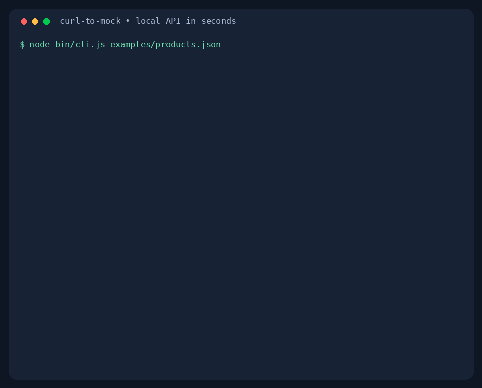

# curl-to-mock

**A JSON file. A working API. One command.**

Build your frontend while the backend catches up. Serve a local JSON fixture with custom status codes, realistic delays, and CORS enabled. Zero runtime dependencies. No account or API key.



## Try it

Requires Node.js 20 or newer. From this repository:

```bash
node bin/cli.js examples/products.json
```

Open **http://127.0.0.1:4000** or run:

```bash
curl http://127.0.0.1:4000
```

For a system-wide local command:

```bash
npm link
curl-to-mock examples/products.json --delay 800
```

The package is not published to npm yet. After publishing, the intended one-command experience is `npx curl-to-mock response.json`.

## Examples

Run each example separately, or assign different ports.

### Products API

```bash
node bin/cli.js examples/products.json --path /products
curl http://127.0.0.1:4000/products
```

### Failed login

```bash
node bin/cli.js examples/login-error.json --path /login --status 401
curl -i -X POST http://127.0.0.1:4000/login
```

### Paginated response with a slow connection

```bash
node bin/cli.js examples/pagination.json --path /users --delay 800
curl 'http://127.0.0.1:4000/users?page=1'
```

Pagination is a static fixture: query parameters do not modify the response.

## Options

| Option | Default | Description |
| --- | --- | --- |
| `--port` | `4000` | Port from 0 to 65535; 0 chooses an available port |
| `--host` | `127.0.0.1` | Network interface to bind; use `0.0.0.0` to expose to your network |
| `--path` | `/` | Exact endpoint path; query strings are ignored |
| `--delay` | `0` | Response delay in milliseconds, up to 60000 |
| `--status` | `200` | HTTP response status from 200 to 599 |
| `--cors` | `*` | Value of Access-Control-Allow-Origin |
| `--help` | | Usage and examples |
| `--version` | | Print the CLI version |

GET, POST, PUT, PATCH, and DELETE return the same fixture. HEAD returns headers only. OPTIONS returns an immediate 204 preflight response, including requested header names. Status codes 204, 205, and 304 return no body. Unmatched paths return JSON with status 404. Credentialed CORS is not supported.

The file is loaded once at startup. Restart the command after editing your fixture. Ctrl+C stops the server.

## Scope

Version 0.1 serves one JSON file on one endpoint. It does not execute shell commands or contact external APIs. Despite the project name, importing a `curl` command is a future feature.

## Development

```bash
npm ci
npm test
npm pack --dry-run
```

Tests exercise real HTTP requests, delays, CORS preflight, status codes, invalid inputs, and CLI startup/shutdown. CI runs on Node.js 20, 22, and 24.

## Roadmap

- [ ] Import a `curl` command to capture a response fixture
- [ ] Multiple routes from a configuration file
- [ ] Watch JSON files and reload on changes

## Contributing

Small focused pull requests are welcome. Include a fixture or regression test for behavior changes, and run `npm test` before submitting. For feature requests, describe the frontend workflow you want to unblock.

## License

MIT — see [LICENSE](LICENSE).
